# WhatsApp B2B Order Recommender

**B2B Order Generation Platform via Instant Messaging and Intelligent Automation**  
Master's Thesis (TFM) — Master's Degree in Artificial Intelligence, Universidad Internacional de La Rioja (UNIR)

- **Author:** Silvina Gattino
- **Thesis director:** Carlos Manuel Moreno Negrin
- **Type:** Experimental pilot · June 2026
- **Full thesis (PDF, in Spanish):** [`Silvina_Nora_Gattino_Deposito_Ordinaria.pdf`](Silvina_Nora_Gattino_Deposito_Ordinaria.pdf)
- **Defense presentation (PDF, in Spanish):** [`TFM_Presentacion_v4.pdf`](TFM_Presentacion_v4.pdf)

---

## 1. Overview

Many wholesale (B2B) businesses receive customer orders as free-text messages over WhatsApp, which staff must then read, interpret and re-type into the management system. This project proposes an AI-based pipeline that:

1. **Interprets** a natural-language product request (e.g. *"pasta dental infantil"* — kids' toothpaste),
2. **Recommends** the best-matching products (and alternatives) from a structured catalog, and
3. **Suggests complementary products** learned from real purchase history,

so that the order can be generated automatically in the company's management system.

The repository contains the two experimental notebooks of the thesis: a **supervised hybrid recommender** and an **unsupervised complementary-product model**.

> **Language note.** The product catalog and the test queries belong to a Spanish-speaking market, so queries, product names and some column names (e.g. `Denominacion`, `Subcategoria`, `Marca`) remain in Spanish inside the code and in the original output figures. All documentation, comments and markdown are in English.

## 2. Architecture

### 2.1 System overview

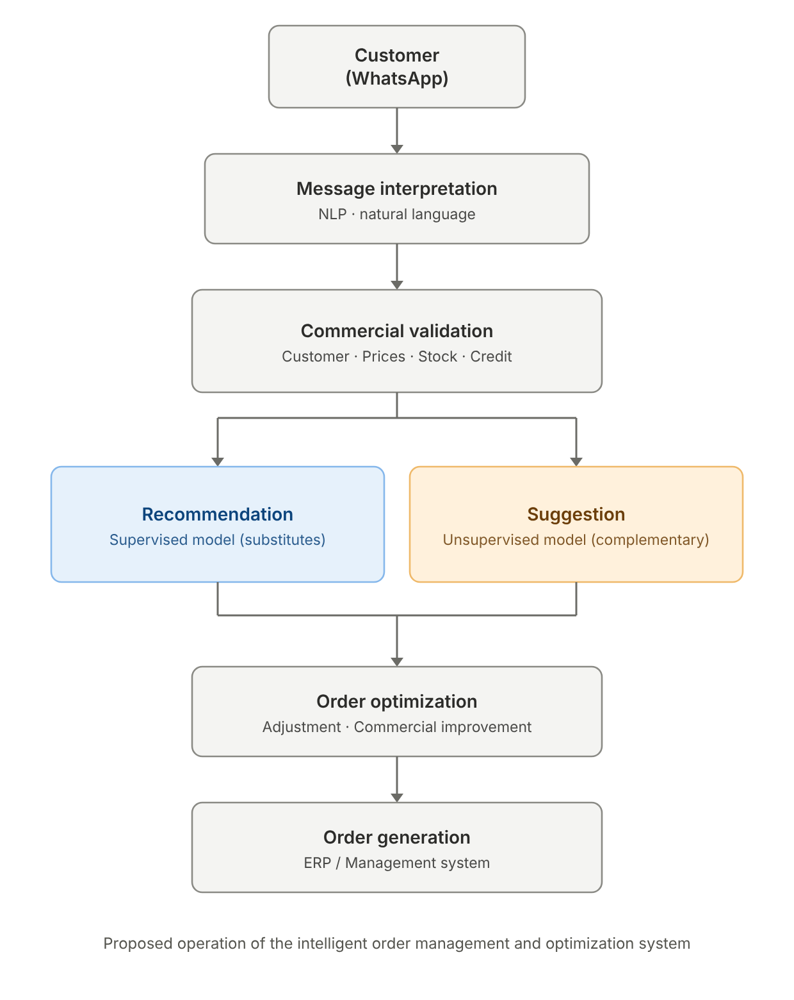
*Figure 1 of the thesis. Proposed operation of the intelligent order management and optimization system.*

A customer sends an order as a free-text WhatsApp message. The system (1) **interprets** the message with NLP, (2) runs a **commercial validation** (customer, prices, stock, credit), and then (3) works with two complementary models in parallel: the **supervised hybrid recommender**, which proposes substitute products, and the **unsupervised model**, which suggests complementary products from purchase history. (4) The proposals are used to **optimize the order**, and (5) the final order is **generated in the company's management system**. This repository implements the two recommendation models (blue and orange boxes).

### 2.2 Supervised hybrid recommender

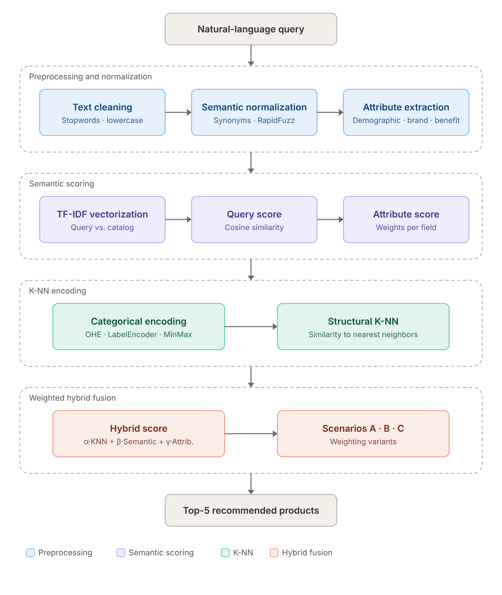
*Figure 5 of the thesis. Conceptual pipeline of the hybrid product recommendation model.*

The query is first cleaned and normalized (synonyms, attribute extraction). It is then scored by **semantic scoring** (TF-IDF, query score and attribute score) and, independently, by a **structural K-NN** over one-hot encoded attributes. The three normalized scores are combined in a **weighted hybrid fusion** (`S_H = α·S_KNN + β·S_C + γ·S_A`), whose weights are varied in scenarios A, B and C, and the system returns the **top-5 products**. Combining both views overcomes the weakness of each one alone: semantic scoring depends on the quality of the product text, while structural K-NN ignores the user's natural vocabulary. Implemented in `Main.ipynb`.

### 2.3 Unsupervised complementary recommender

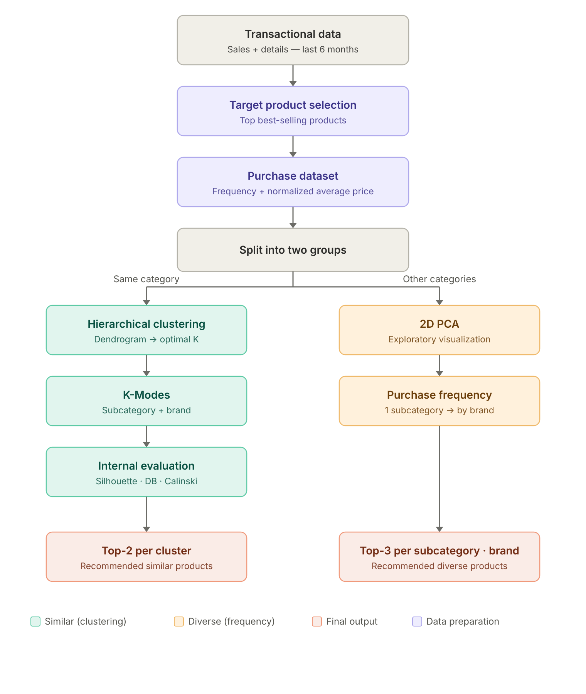
*Figure 6 of the thesis. Pipeline of the unsupervised model for complementary products.*

Starting from six months of sales, the best-selling products are chosen as targets and a purchase dataset (frequency and normalized average price) is built. Co-purchased products are split into two groups: **same category** (similar products), handled with hierarchical clustering to choose K, then K-Modes on subcategory and brand, validated with Silhouette, Davies-Bouldin and Calinski-Harabasz and reduced to the top-2 per cluster; and **other categories** (diverse products), handled with a direct purchase-frequency analysis (top-3 per subcategory and brand) because clustering is not discriminative on such heterogeneous items. Implemented in `Main_NS.ipynb`.

## 3. Methodology

### 3.1 Supervised hybrid recommender (`Main.ipynb`)

| Stage | Technique |
|---|---|
| Text normalization | Accent/symbol removal, unit normalization (g, ml), synonym dictionary (e.g. *kids → INFANTIL*, *charcoal → CARBON*) |
| Category retrieval | **RapidFuzz** `partial_ratio` over categories; **TF-IDF + cosine similarity** fallback when no match is found |
| Query Score (SC) | RapidFuzz `token_set_ratio` against an enriched product text × query-token coverage |
| Attribute Score (SA) | Weighted sum of attribute/value matches: `SA = Σ pa_i × pv_i` (business-rule weights) |
| Semantic Score (SS) | `SS = SC × 0.70 + SA × 0.30` |
| Structural K-NN | One-Hot Encoding + `StandardScaler` for numeric variables; cosine similarity between query vector and product vectors (`ScoreKNN`) |
| Hybrid fusion | `S_H = α·S_KNN_n + β·S_C_n + γ·S_A_n` with MinMax-normalized components (α+β+γ = 1) |
| Scenarios | **A** Balanced (α=0.25, β=0.50, γ=0.25) · **B** Strong semantic (0.10, 0.70, 0.20) · **C** Strong structural (0.50, 0.30, 0.20) |
| Evaluation | Precision, Recall, Accuracy and F1-Score on top-5 results against a manually defined **ground truth** |

### 3.2 Unsupervised complementary recommendation (`Main_NS.ipynb`)

- Starting point: the **last six months** of sales history; the best-selling products are used as reference (target) products.
- Co-purchased products are split into two groups:
  - **Similar products** (same category, different subcategory) → clustering by subcategory and brand with **Agglomerative Hierarchical Clustering** (Ward linkage, dendrogram used to choose *K*) and **K-Modes** (Huang initialization); top products per cluster by purchase frequency.
  - **Diverse products** (other categories) → direct purchase-frequency analysis (top-3 per subcategory and brand), since clustering loses discriminative power on highly heterogeneous groups.
- Cluster quality is checked with Silhouette, Davies-Bouldin and Calinski-Harabasz indices (K-Prototypes is used to obtain a Silhouette on mixed variables).

## 4. Results

### 4.1 Evaluation of the hybrid model

Macro-average over 6 test queries (top-5 results vs. manual ground truth):

| Model | Precision | Recall | Accuracy | F1-Score |
|---|---|---|---|---|
| Original scoring | 0.83 | 0.81 | 0.96 | 0.79 |
| Scenario A — Balanced | 0.80 | 0.79 | 0.95 | 0.77 |
| Scenario B — Strong semantic | 0.80 | 0.79 | 0.95 | 0.77 |
| Scenario C — Strong structural | 0.70 | 0.71 | 0.93 | 0.68 |

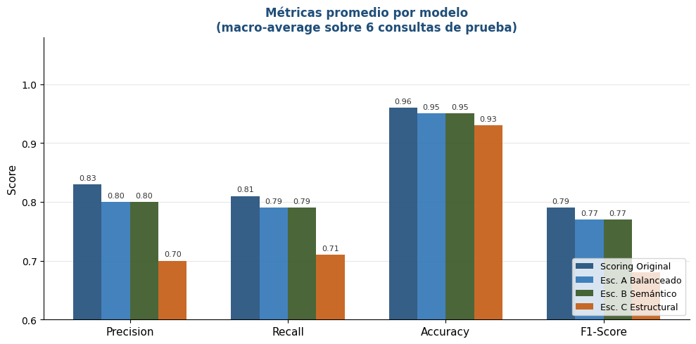
*Average Precision / Recall / Accuracy / F1 per model (labels in Spanish: "Esc." = Scenario, "Balanceado" = Balanced, "Semántico" = Semantic, "Estructural" = Structural).*

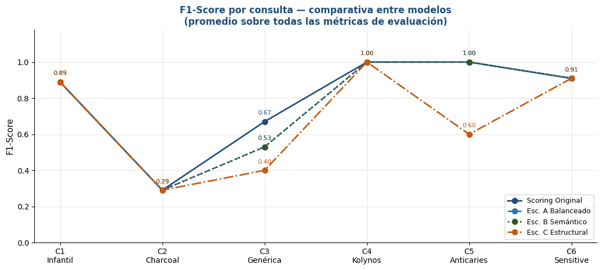
*F1-Score per test query and model (C1 Infantil = kids, C2 Charcoal, C3 Genérica = generic, C4 Kolynos, C5 Anticaries = anti-cavity, C6 Sensitive).*

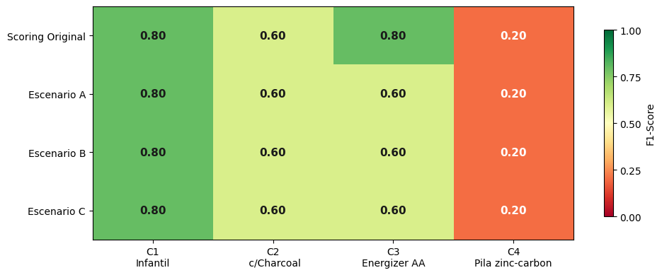
*F1-Score heatmap by query and model.*

### 4.2 Exploratory analysis of the structured attributes

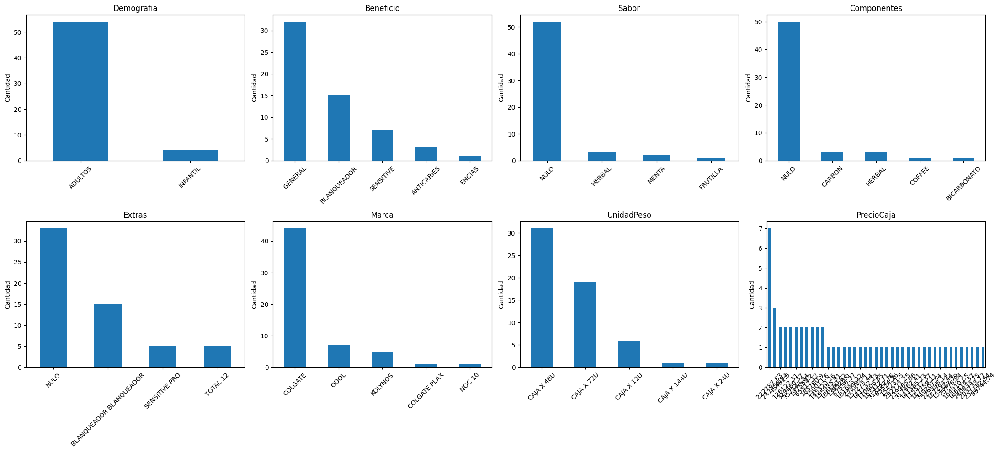
*Distribution of the generated product attributes (Demografia, Beneficio, Sabor, Componentes, Extras, Marca, UnidadPeso, PrecioCaja). "NULO" = null.*

### 4.3 Unsupervised complementary recommendation

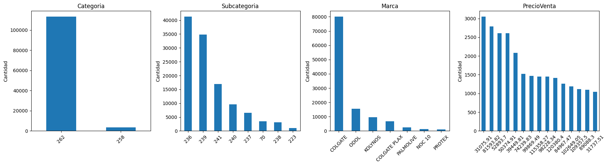
*Exploratory analysis of the sales table (category, subcategory, brand, price).*

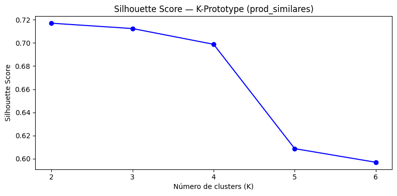
*Silhouette score as a function of the number of clusters (K-Prototypes).*

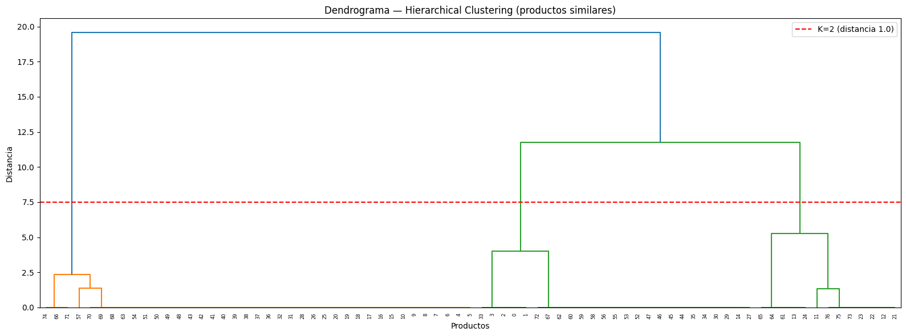
*Dendrogram of the hierarchical clustering on similar products ("Distancia" = distance, "Productos" = products); used to select K.*

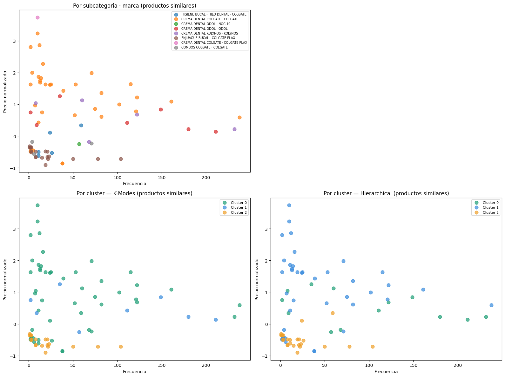
*Similar products by subcategory·brand, and by K-Modes and Hierarchical cluster (x: purchase frequency, y: normalized price).*

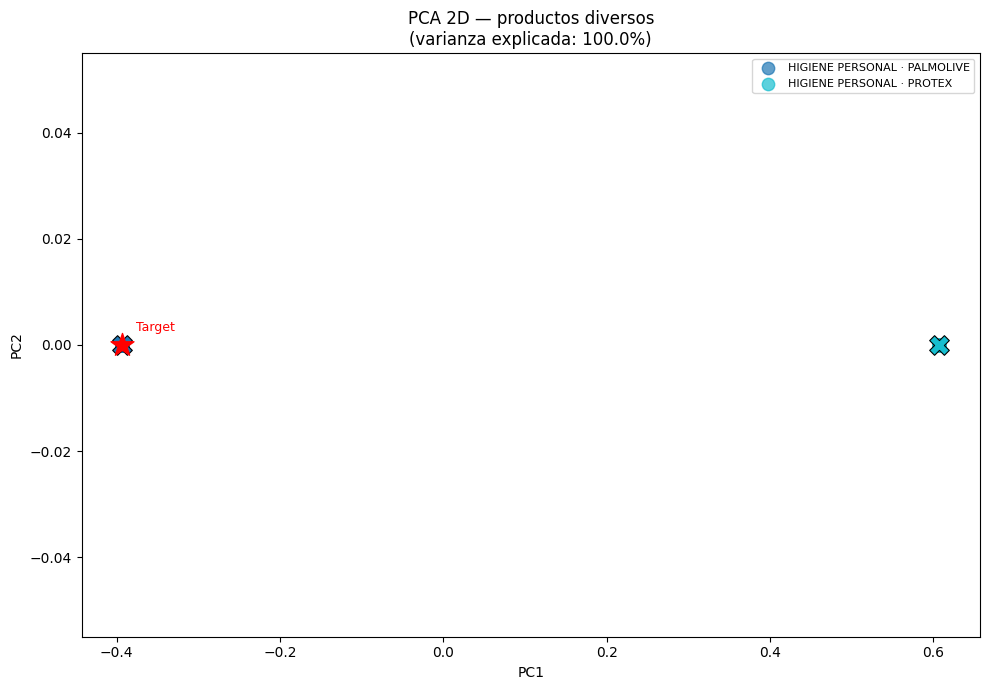
*2D PCA of the diverse products group.*

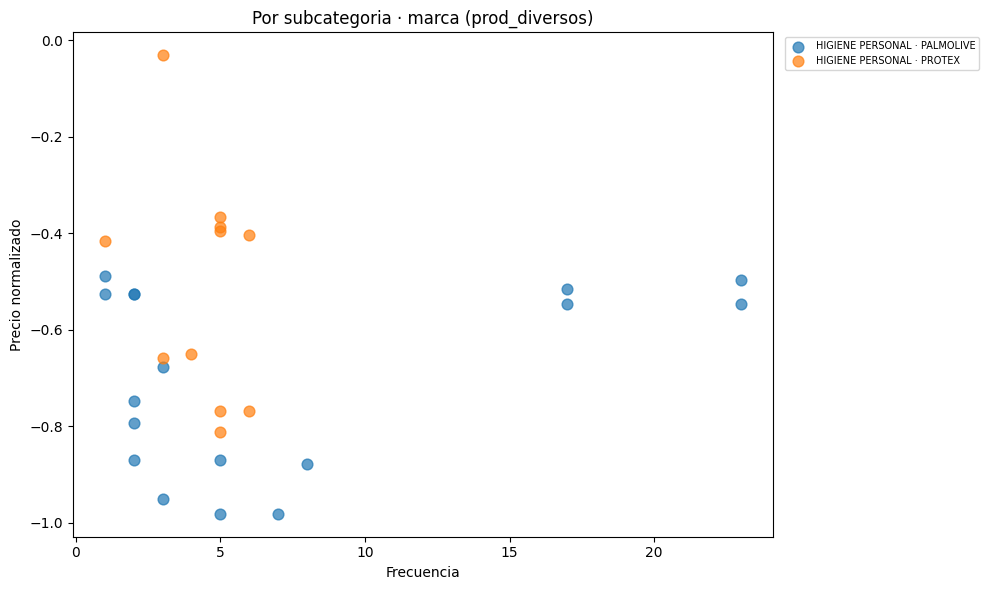
*Diverse products by subcategory·brand (frequency vs. normalized price).*

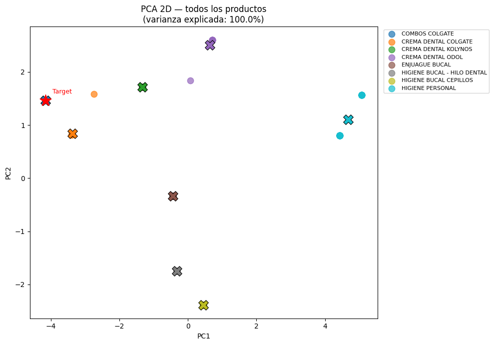
*2D PCA of all products with the target product highlighted.*

## 5. Repository structure

```
whatsapp-b2b-order-recommender/
├── README.md
├── requirements.txt
├── .gitignore
├── Main.ipynb                       # Supervised hybrid recommender (NLP + RapidFuzz + TF-IDF + K-NN)
├── Main_NS.ipynb                    # Unsupervised complementary recommender (Hierarchical + K-Modes)
├── Figures/                         # Pipeline diagrams and figures extracted from the notebook outputs
├── Silvina_Nora_Gattino_Deposito_Ordinaria.pdf   # Full thesis (Spanish)
└── TFM_Presentacion_v4.pdf                       # Defense presentation (Spanish)
```

## 6. How to run

The notebooks were developed in **Google Colab** (Python 3). The underlying datasets come from a real wholesale company and are **not included** in this repository for confidentiality reasons.

1. Install the dependencies: `pip install -r requirements.txt`
2. Provide your own CSV files with the same structure as the original datasets (products, product categories, attributes, category attributes, attribute values and sales), and set `base_path` in the data-loading cell of each notebook (the default `drive/MyDrive/TFM/` is a Google Drive path used in Colab).
3. Set `consulta_query` (the user query) and run the cells in order.

Expected input tables: `Productos_Proveedor_828_718.csv`, `Productos_Categorias.csv`, `Atributos.csv`, `Categorias_Atributos.csv`, `Categorias_Atributos_Valor.csv` (`Main.ipynb`) and `Ventas_117.txt`, `Productos_Categorias.csv` (`Main_NS.ipynb`).

The outputs stored in the notebooks are those of the original experiment run.

## 7. Main technologies

Python · pandas · NumPy · scikit-learn · RapidFuzz · kmodes · SciPy · Matplotlib · Seaborn · Plotly

## 8. Citation

> Gattino, S. (2026). *B2B Order Generation Platform via Instant Messaging and Intelligent Automation* [Master's thesis, Universidad Internacional de La Rioja]. Director: C. M. Moreno Negrin.
